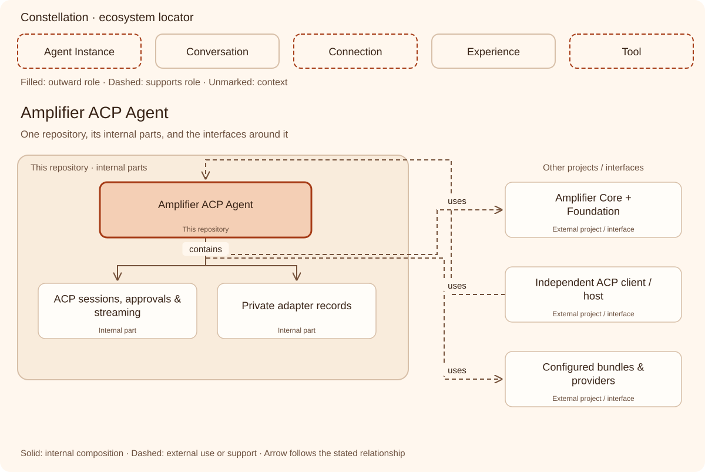

# Amplifier ACP agent

Connect an ACP-compatible client to the full Amplifier runtime. This adapter
runs configured Amplifier bundles with their providers, tools, context, delegation
and approvals, and streams results through the Agent Client Protocol.

This repository is for client integrators and people operating an ACP endpoint.
For a ready-to-use conversation experience, start with
[Amplifier Unified](https://github.com/microsoft/amplifier-unified).

## Get started

You need Python 3.13+, uv, Git, and access to this repository and its dependencies.
Configure the Amplifier bundle and provider credentials you intend to use.

```sh
git clone https://github.com/microsoft/amplifier-app-acp.git
cd amplifier-app-acp
uv sync --no-dev
```

Create a private configuration file with paths owned by this installation:

```json
{
  "home": "/absolute/amplifier-home",
  "appHome": "/absolute/acp-state",
  "bundle": "work"
}
```

Then configure your ACP client to launch:

```sh
uv run --project /absolute/path/to/amplifier-app-acp --no-dev \
  amplifier-acp --config /absolute/agent.json
```

Set `--project` to the checkout's absolute path so launch does not depend on the
ACP client's working directory.

The client exchanges ACP v1 JSON messages over the process's standard input and
output. Running that command in a terminal starts the endpoint; it is not an
interactive chat prompt. The client must retain the connection while work runs.

`home` holds native Amplifier settings and history. `appHome` holds this adapter's
private configuration and records. Keep provider credentials in native
configuration or the environment, not in ACP messages. Use separate owned homes
for experiments.

## What clients can do

Create, load and resume conversations; send text and supported resources; receive
streaming output and tool progress; request cancellation; and handle permission
requests. Model and mode changes use standard ACP configuration where supported.
Additional Amplifier controls are negotiated extensions, not requirements for an
ordinary ACP client. Audio uses a separate capability.

## Integration guides

- [ACP extensions](docs/extensions.md) and [host integration](docs/host-bridge.md)
- [Configuration](docs/standard-configuration.md) and
  [provider authentication](docs/provider-authentication.md)
- [Permissions](docs/permissions.md) and [session lifecycle](docs/session-lifecycle.md)
- [Native agent contract](contracts/native-agent.v1.md) and [contributor entry](AGENTS.md)


<!-- ecosystem-map:start -->
## Where this fits

An ACP execution adapter exposing configured Amplifier bundles to independent clients.

Supports: Agent Instance, Connection, Tool.



[Open the map](docs/ecosystem-map.svg) · [Product page source (private)](docs/product/index.html) · [Map guide](https://github.com/microsoft/amplifier-constellation/blob/main/docs/ecosystem-maps.md)

<details>
<summary>The five shared building blocks</summary>

[](https://microsoft.github.io/amplifier-constellation/)

</details>

<!-- ecosystem-map:end -->

## Contributing

Most contributions require you to agree to a
Contributor License Agreement (CLA) declaring that you have the right to, and actually do, grant us
the rights to use your contribution. For details, visit [Contributor License Agreements](https://cla.opensource.microsoft.com).

When you submit a pull request, a CLA bot will automatically determine whether you need to provide
a CLA and decorate the PR appropriately (e.g., status check, comment). Simply follow the instructions
provided by the bot. You will only need to do this once across all repos using our CLA.

This project has adopted the [Microsoft Open Source Code of Conduct](https://opensource.microsoft.com/codeofconduct/).
For more information see the [Code of Conduct FAQ](https://opensource.microsoft.com/codeofconduct/faq/) or
contact [opencode@microsoft.com](mailto:opencode@microsoft.com) with any additional questions or comments.

## Trademarks

This project may contain trademarks or logos for projects, products, or services. Authorized use of Microsoft
trademarks or logos is subject to and must follow
[Microsoft's Trademark & Brand Guidelines](https://www.microsoft.com/legal/intellectualproperty/trademarks/usage/general).
Use of Microsoft trademarks or logos in modified versions of this project must not cause confusion or imply Microsoft sponsorship.
Any use of third-party trademarks or logos are subject to those third-party's policies.
